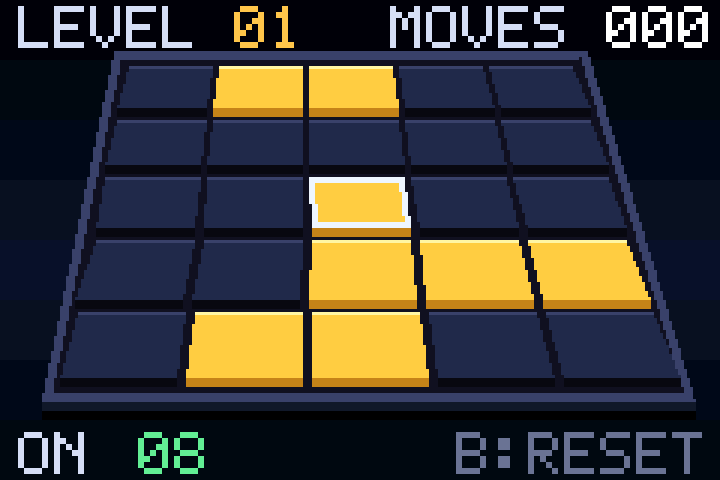

# LIGHTS OUT GBA

Một bản **Lights Out** 5×5 hoàn chỉnh cho Game Boy Advance, viết hoàn toàn bằng
mã máy ARMv4T tự lắp ráp. **Không dùng devkit, không C compiler, không thư viện
ngoài** — chỉ có một bộ assembler mini và bộ ghi ROM bằng JavaScript.



## Chơi

Nạp `lightsout.gba` vào mGBA, VisualBoyAdvance-M, gpSP hoặc máy GBA thật.

#VIETNAMESE

| Nút | Tác dụng |
| --- | --- |
| D-pad | Di chuyển con trỏ trên bàn đèn |
| A | Lật ô đang chọn và 4 ô kề (hình chữ thập) |
| B | Chơi lại màn hiện tại |
| L / R | Nghiêng góc nhìn 3D sang trái / phải (7 mức) |
| START | Ở màn hình tiêu đề: bắt đầu. Trong game: tạo màn mới cùng cấp |
| SELECT | Bật / tắt âm thanh |

### Luật chơi

* Bàn có 25 ô đèn. Mỗi lần nhấn **A**, ô đang chọn và bốn ô kề trên/dưới/trái/phải
  cùng đổi trạng thái (đang sáng → tắt, đang tắt → sáng).
* Mục tiêu: **tắt hết tất cả đèn**. Khi thắng, khung `SOLVED` hiện ra; nhấn **A**
  để sang màn kế tiếp.
* Màn thứ `L` được xáo bằng `4 + 2×L` nước đi ngẫu nhiên (tối đa 26). Vì được tạo
  bằng cách xáo từ bàn trống nên **màn nào cũng có lời giải**.
* HUD hiển thị `LEVEL`, `MOVES` (số nước đã đi) và `ON` (số đèn còn sáng).

#ENGLISH

| Button | Function |
| --- | --- |
| D-pad | Move the cursor on the light grid |
| A | Toggle the selected cell and its 4 adjacent cells (in a cross pattern) |
| B | Restart the current level |
| L / R | Tilt the 3D perspective to the left / right (7 levels) |
| START | On the title screen: start the game. During gameplay: generate a new level of the same difficulty |
| SELECT | Toggle sound on / off |

### Rules

* The grid consists of 25 lights. Pressing **A** toggles the state of the selected cell and its four neighbors (above, below, left, and right)—turning lit cells off and unlit cells on.
* Objective: **turn off all the lights**. Upon winning, a `SOLVED` indicator appears; press **A** to proceed to the next level.
* Level `L` is generated by applying `4 + 2×L` random moves (up to a maximum of 26). Since every level is created by scrambling an empty grid, **every level is guaranteed to have a solution**.
* The HUD displays `LEVEL`, `MOVES` (number of moves made), and `ON` (number of lights remaining lit).

## Build

Yêu cầu duy nhất: **Node.js** (không cần cài thêm gói nào).

```
node make.js
```

Kết quả: `lightsout.gba` — 262.144 byte (256 KiB), phần mã 7.544 byte.

Bàn đèn trong game được dựng **3D phối cảnh**: hàng xa hẹp và thấp hơn, hàng gần
rộng và cao hơn, mỗi ô là một khối nổi có mặt trên, sườn trước và bóng đổ. Nhấn
**L/R** để xoay nhẹ góc nhìn qua lại giữa 7 mức (lệch ngang −18…+18 pixel).

Màn tiêu đề có nền gradient, logo hai màu, khung bàn đèn demo tự giải và nút
`PRESS START`; dòng điều khiển dưới cùng là `A FLIP  B RESET  L/R VIEW  START NEW`.
Chữ HUD và bảng `SOLVED` dùng font 5×7 phóng 2× để dễ đọc.

Các lệnh hữu ích khác:

```
node check.js   # chạy bộ kiểm thử tự động (dựng lại ROM + 32 phép kiểm tra)
node run.js     # chạy trong trình giả lập tích hợp, xuất ảnh chụp màn hình
node perf.js    # đo chi phí chu kỳ của một lần vẽ lại
```

## Cấu trúc dự án

| Tệp | Chức năng |
| --- | --- |
| `asm.js` | Assembler ARMv4T hai lượt: literal pool, fixup nhánh, điều kiện, load/store nửa từ |
| `build.js` | Ghi header GBA hợp lệ, logo Nintendo và boot stub chép payload vào IWRAM |
| `game.js` | Toàn bộ logic, bộ rasterizer 3D phối cảnh, phần vẽ và âm thanh của game |
| `emu.js` | Trình giả lập GBA tối giản dùng cho kiểm thử headless |
| `font.js` | Font bitmap 5×7 và bảng chuỗi |
| `png.js` | Bộ mã hoá PNG nhỏ để xuất ảnh kiểm thử |
| `make.js` | Dựng `lightsout.gba` |
| `check.js` | Bộ test tự động, gồm cả bộ giải Lights Out độc lập |
| `run.js` | Chạy game và xuất ảnh `shot_*.png` |
| `perf.js` | Đo ngân sách chu kỳ mỗi khung hình |
| `mgba_gdb_test.ps1` | Điều khiển mGBA thật qua GDB stub và đọc biến của game |
| `vba_full_test.ps1` | Chụp màn hình VBA-M khi bấm phím |
| `vbacheck.js` | Phân tích ảnh chụp: khớp hình học phối cảnh, đọc bàn đèn và vị trí con trỏ |

## Cách hoạt động (không devkit)

* **Mã máy tự sinh:** `asm.js` lắp ráp chương trình ARM tại `0x03000000`
  (IWRAM). Mỗi hàm dùng `ldrk` đều kết thúc bằng `A.pool()` để đặt literal pool.
* **ROM thủ công:** `build.js` tạo ảnh ROM 256 KiB với header GBA, logo Nintendo
  và một boot stub nhỏ chép payload từ ROM vào IWRAM rồi nhảy tới `0x03000000`.
* **Đồ hoạ 3D phần mềm:** Mode 4, 240×160, 8bpp. Bàn 5×5 được chiếu phối cảnh
  thành các hình thang; `fill_trap` tô từng dòng quét với bước cạnh 8.8 cố định.
  Mỗi mức nghiêng có sẵn 3 hình thang cho mặt bàn và 25 hình thang cho các ô
  (bảng `slabs3d`, `cells3d`), vẽ từ hàng xa đến hàng gần. HUD và khung `SOLVED`
  vẫn dùng `rect`, `fill`, `draw_str`, `draw_num`.
* **Double buffering:** game vẽ vào trang VRAM đang ẩn, chỉ lật trang khi đã vẽ
  xong (`V.T0` là cờ báo có khung mới). Nhờ vậy hình không bị nhấp nháy 30 Hz.
* **Sinh màn:** một LCG 32-bit đầy đủ chu kỳ chọn ngẫu nhiên các ô để xáo; nếu
  vô tình ra bàn trống thì game lật thêm ô giữa để màn luôn có đèn.
* **Âm thanh:** kênh PSG 2 của GBA, có ba nốt đi lên khi giải xong màn.

## Kiểm thử

`node check.js` chạy 32 phép kiểm tra và kết thúc bằng `ALL OK`, bao gồm:

* khởi động, màn tiêu đề, bắt đầu game;
* bộ giải Lights Out **độc lập** (không dùng bảng mask của game) giải màn 1
  trong 14 nước;
* di chuyển và kẹp con trỏ ở biên;
* lật đèn, đếm nước đi, đếm số đèn sáng;
* B chơi lại, START tạo màn mới, SELECT tắt/bật âm thanh;
* ăn màn → lên cấp → màn mới;
* đúng một khung logic cho mỗi khung hình hiển thị;
* L/R đổi mức nghiêng 3D mà không làm thay đổi màn chơi.
* ảnh VRAM được lấy đúng tâm từng ô phối cảnh để đối chiếu với bitmask đèn.

Kết quả trên máy kiểm thử:

* **mGBA 0.10.5** — điều khiển đầy đủ qua GDB stub: START, D-pad, A, B, SELECT,
  L, R đều đúng; các giá trị `lights`, `moves`, `count`, `yaw` khớp chính xác
  với bản chạy headless (L: yaw 4→5, R: 5→4).
* **VisualBoyAdvance-M 2.2.3** — ROM khởi động, hiển thị đúng bàn 3D; ảnh chụp
  được phân tích tự động bằng `vbacheck.js` (đã đọc theo hình học phối cảnh):
  màn 1 ra `0x6e1006`, sau khi lật ra `0x6c2886`, con trỏ `2,2`.
* **gpSP** chưa cài trên máy kiểm thử. ROM chỉ dùng phần cứng GBA chuẩn
  (Mode 4, keypad, PSG, VBlank) nên về lý thuyết tương thích với gpSP và máy thật.

## Ghi chú kỹ thuật

* Biến game nằm ở `0x03007000`; stack ở `0x03007E00`.
* Bit `1` = đèn sáng. Màn 1 đầu tiên luôn là `0x6E1006` (8 đèn sáng); màn mới
  sau khi nhấn START là `0x9FA119`.
* Mỗi ô có một mask 25 bit riêng; nhấn A chỉ cần XOR mask vào `LIGHTS`.
* Không có save pin — mọi tiến trình nằm trong RAM và mất khi tắt máy.
* VBA-M có bộ lọc LCD và hiệu chỉnh màu `srgb` nên màu hiển thị hơi khác bảng
  màu gốc; logic và bố cục ô hoàn toàn không đổi.
